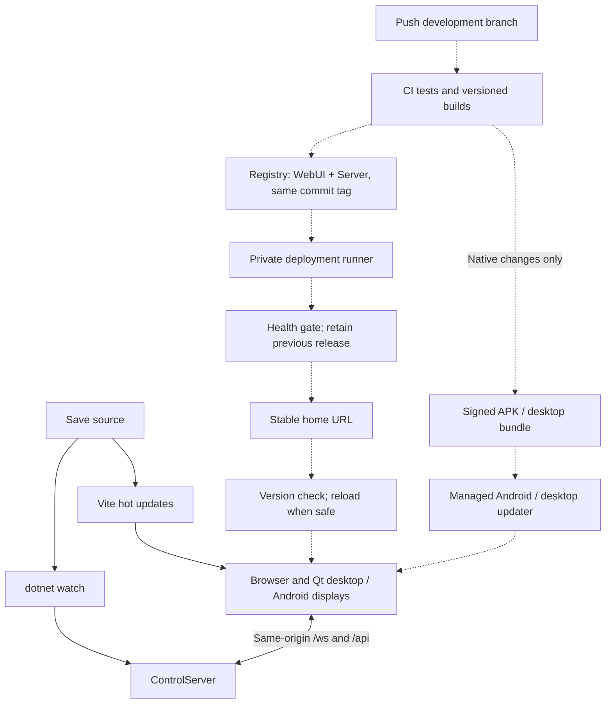

# Development and deployment

## The key rule

All displays load one stable WebUI address. The gateway forwards /ws and /api to the ControlServer. App panels never know container names, IPs or provider credentials. Rebuilding a web app does not require installing it on every display.

## Live development (wired locally)

From the repo root, use separate terminals:

```powershell
npm run dev:server
npm run dev:connected
```

Connected UI: http://127.0.0.1:5175/. Vite proxies the server on port 8080. UI saves update through Vite HMR; dotnet watch rebuilds/restarts server changes, and clients reconnect without replaying commands. The fixture preview stays separate on port 5174.

For the S24 FE, deliberately expose the development UI on your trusted private LAN using Vite's --host option and configure the native wrapper once with that LAN address. Do not open a development server to the Internet. No firewall rule, public ingress or LAN exposure was enabled automatically. API keys remain on the server. Existing saved fixture endpoints can be changed at /setup.

Native C++/QML changes still require rebuilding/installing the wrapper; web HMR cannot change native code.

## Automatic rollout (proposed, not enabled)



Solid arrows describe the live-development setup available in this repository; dashed arrows are the release automation to provision. No CI workflow, registry push, remote runner or native updater was silently activated.

### One-time setup

1. Choose the deployment machine, source-control CI provider and private image registry. Give the server a stable LAN DNS name / reservation and HTTPS gateway.
2. Configure CI to run frontend lint/tests/build, .NET builds and the appropriate native build jobs. Run native desktop/Android packaging on a trusted Windows builder with matching Qt/JDK/SDK kits. Keep Qt licensing compliant; never auto-accept new licences in CI.
3. Publish both server and WebUI images under the same immutable commit/release tag. Do not deploy independently floating latest images: build completion is not rollout success.
4. Install a private runner on the deployment host. Restrict it to trusted branches; never run untrusted fork code with Docker socket, production secrets or signing access. Store provider credentials on the host/secret store, not the frontend/image/repository.
5. On a trusted development-branch update, have the runner pull the exact tag, take a supported data backup, recreate both services with the same network/volume, then wait for health and WebSocket smoke checks. Pin the previous tag for rollback. Database migrations need an explicit compatibility/rollback policy; do not assume rolling images back reverses a schema migration.
6. Add a public non-secret release identity endpoint to the gateway and client-side safe reload handling. Do not reload during an unsaved edit or in-flight command; retain timer/app state before swapping. This version-event/reload step is not implemented yet. Without it, deployed web assets become visible on next navigation/reload, not magically in an already-open tab.
7. Install/enrol the Qt wrapper once per display with the stable URL. Android production builds need an owned signing key and incrementing versionCode; desktop native updates need a platform updater/service. Only native wrapper changes travel through those channels.

Android unattended APK installation requires suitable managed-device distribution; the existing development APK is not an MDM agent. See [Android's dedicated-device guidance](https://developer.android.com/work/dpc/dedicated-devices/cookbook). Do not factory-reset or enrol a personal S24 FE as device owner without an explicit user decision.

## What is actually implemented

- App-owned project configuration and shared output conventions under Deployments.
- Source Compose network, same-origin reverse proxy and health checks.
- Versioned release assembly, all-application quality gates and SHA-256 manifests.
- Stable app output folders under Deployments, promoted only after every requested app build succeeds; no timestamp folders or latest pointer.
- Desktop Qt wrapper loading a configured URL and an ARM64 Android test APK.
- First-run WebUI server identity check and saved per-display connection settings.

## Release blockers still to resolve

- Re-run target Docker smoke checks after deployment changes; the Pi stack and runner are already provisioned, not merely proposed.
- Migrate/recreate accounts from the former process-only profile implementation before its first upgrade. New accounts persist through AccountRepository; back up their encryption keys with the account file.
- Existing authentication/authorization, transport concurrency and hosted-service lifecycle hardening.
- Review .NET 9 and installed Qt versions against supported security/LTS baselines.
- Production TLS/Android cleartext restriction, release signing, physical-device validation.
- Continue protecting the configured GitHub/Pi runner and GHCR access. An automatic client reload/update prompt is not yet implemented for already-open WebUI sessions.

These are not hidden by a successful build. The active GitHub/Pi rollout is documented in [GitHub deployment](GitHub-Deployment.md); the diagram also illustrates future native distribution work, which is not the same as Docker rollout.
